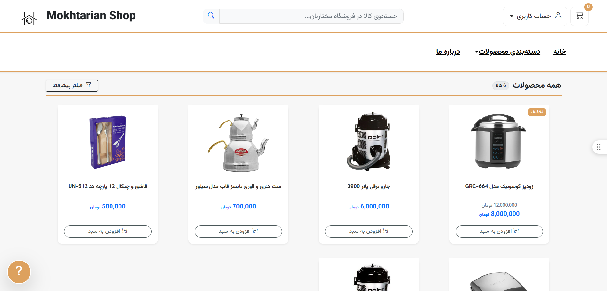
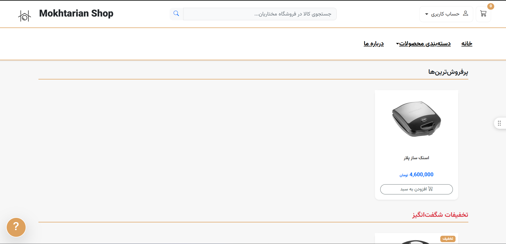
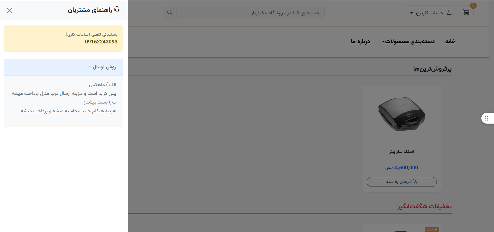
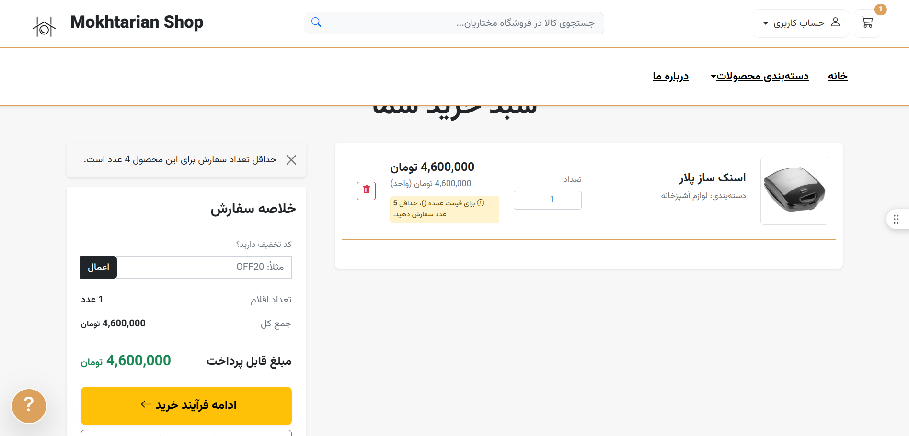

📌 معرفی پروژه

پروژهٔ Mokhtarian Store با هدف توسعهٔ یک فروشگاه اینترنتی ایجاد شده است. این مخزن شامل کدهای پروژه بوده و می‌تواند برای توسعه، نگهداری و بهبود قابلیت‌های فروشگاه مورد استفاده قرار گیرد.

✨ امکانات پروژه

قابلیت‌های زیر را متناسب با امکانات پیاده‌سازی‌شده در پروژه تکمیل کنید:

🛒 نمایش و مدیریت محصولات

🔎 جست‌وجو و دسته‌بندی محصولات

👤 مدیریت کاربران و حساب‌های کاربری

📦 مدیریت سفارش‌ها

💳 پشتیبانی از فرایند خرید و پرداخت

📱 طراحی واکنش‌گرا برای دستگاه‌های مختلف

🔐 مدیریت دسترسی و امنیت

